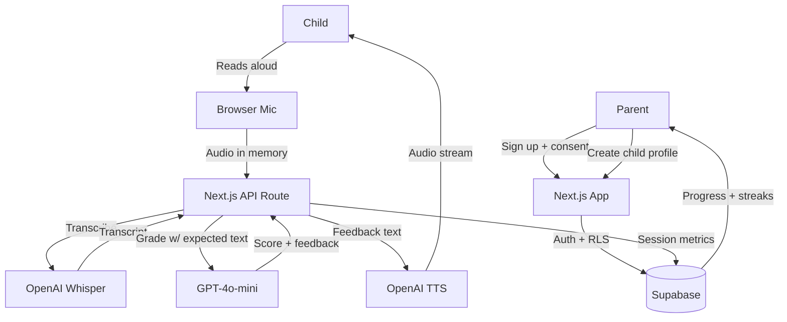

# ReadSpark: Architecture and Implementation Specification

## Overview

ReadSpark is an AI-powered reading assistant built to help children ages 5 to 8 practice reading aloud. It focuses on a single, measurable skill: reading fluency and phonics. Because parents are the core buyers, the product combines child-friendly UX with progress tracking, streaks, and parental oversight.

## Core Concept

- Helps children practice reading aloud in a short, focused session.
- Keeps the experience engaging with a simple, low-distraction interface.
- Uses speech-to-text and grading logic to evaluate reading quality.
- Provides encouraging feedback and audio playback.
- Enforces a hard session cap to keep sessions short and manageable.
- Prioritizes COPPA-safe, privacy-first behavior.

---

## Recommended Tech Stack

| Layer           | Recommendation                                              |
| --------------- | ----------------------------------------------------------- |
| Frontend        | Next.js with App Router (React 19, Server Components)       |
| Backend         | Next.js Route Handlers (Edge / Node runtime as appropriate) |
| Database & Auth | Supabase (PostgreSQL + Auth + RLS)                          |
| Speech-to-text  | OpenAI Whisper (`whisper-1`) or `gpt-4o-mini-transcribe`    |
| Text-to-speech  | OpenAI TTS (`gpt-4o-mini-tts`)                              |
| LLM grading     | GPT-4o-mini (Structured Outputs)                            |
| Hosting         | Vercel                                                      |
| Payments        | Stripe (Subscriptions + Customer Portal)                    |
| Observability   | Sentry + Vercel Analytics                                   |

---

## System Architecture

### Data Flow

1. A parent signs up and completes the consent flow.
2. The parent registers a child profile and reading level.
3. The child opens the reading interface and reads a short text snippet.
4. Browser audio is captured and sent to the backend **in memory**.
5. The backend passes the audio to Whisper for transcription.
6. GPT-4o-mini compares the transcript to the expected text and calculates accuracy.
7. The backend returns encouraging feedback and TTS audio to the child.
8. Session metrics are saved for the parent dashboard.

### Diagram



---

## Project Structure

```text
readspark/
├── src/
│   ├── app/
│   │   ├── (parent)/       # Parent dashboard, billing, consent, summaries
│   │   ├── (child)/        # Minimal reading interface
│   │   └── api/            # Audio proxy, grading, TTS endpoints
│   ├── components/         # UI such as streak counters and reading helpers
│   ├── lib/                # Supabase and OpenAI wrappers
│   └── utils/              # Audio conversion and formatting helpers
├── public/
├── supabase/
│   └── migrations/         # SQL migrations for schema + RLS
├── .env.example
├── next.config.ts
├── tailwind.config.ts
└── package.json
```

---

## Data Model

| Model          | Key fields                                                                         |
| -------------- | ---------------------------------------------------------------------------------- |
| Parent / User  | `id`, `email`, `stripe_customer_id`, `consent_verified_at`                         |
| ChildProfile   | `id`, `parent_id`, `nickname`, `reading_level`, `target_language`                  |
| ReadingSession | `id`, `child_id`, `duration_seconds`, `words_read`, `accuracy_score`, `created_at` |
| Streaks        | `child_id`, `current_streak`, `last_session_date`                                  |

> 🔒 No child emails, no exact birth dates. All accounts tie back to a parent identity.

---

## API Specification

- `POST /api/consent` — handle verifiable parental consent.
- `POST /api/speech-to-text` — receive audio and proxy it to Whisper; discard buffers immediately.
- `POST /api/grade-reading` — compare text and score reading accuracy.
- `POST /api/tts` — stream encouraging TTS audio back to the child.
- `GET /api/sessions/summary` — weekly summary for the parent dashboard.
- `POST /api/stripe/webhook` — handle subscription lifecycle events.

**Auth:** All endpoints require a Supabase-authenticated session. Row Level Security enforces that parents can only access their own family data.

---

## AI Implementation

- Use Whisper for transcription, passing the expected text as a **prompt bias** to improve accuracy on short, predictable passages.
- Keep all audio processing **in memory**; never write audio to the filesystem.
- Use GPT-4o-mini with **Structured Outputs** to grade reading performance and generate short encouraging feedback:

```json
{
  "accuracy_score": 0.0,
  "words_correct": 0,
  "words_missed": 0,
  "mispronounced": ["word1", "word2"],
  "feedback": "Short, kind, one or two sentences max."
}
```

- Measure exact session economics (per-session Whisper + GPT + TTS cost) to maintain healthy margins.

### Prompting Guidelines

> "You are a friendly reading coach for children ages 5–8. Compare the child's transcript to the expected passage. Do not penalize for dropped filler words. Do not calculate beyond the provided inputs. Return only the structured JSON. Feedback must be 1–2 short, encouraging sentences."

---

## Security and Environment Management

- **Do not** collect a child's email or exact birth date.
- Keep all accounts tied to **parent identities**.
- Use zero-retention settings where applicable for privacy compliance (OpenAI + Supabase).
- Store access keys in environment variables. Never hardcode.
- Enforce Supabase RLS on every table so parents only see their own children's data.
- Account deletion must cascade and remove all child records.

### `.env.example`

```env
# --- Supabase ---
NEXT_PUBLIC_SUPABASE_URL=...
NEXT_PUBLIC_SUPABASE_ANON_KEY=...
SUPABASE_SERVICE_ROLE_KEY=...

# --- OpenAI ---
OPENAI_API_KEY=...
OPENAI_WHISPER_MODEL=whisper-1
OPENAI_TTS_MODEL=gpt-4o-mini-tts
OPENAI_GRADING_MODEL=gpt-4o-mini

# --- Stripe ---
STRIPE_SECRET_KEY=...
STRIPE_WEBHOOK_SECRET=...
NEXT_PUBLIC_STRIPE_PUBLISHABLE_KEY=...

# --- App ---
NEXT_PUBLIC_APP_URL=http://localhost:3000
SESSION_HARD_CAP_SECONDS=600
```

Validate config at startup using `zod` schemas for the server environment.

---

## Best Practices

- Keep the child interface highly visual and simple, with **large typography** and **no distracting links**.
- **Stream TTS audio** back to the client to minimize perceived lag.
- Consider cross-browser audio compatibility, especially for **iOS Safari** and **Chrome**.
- Calculate **per-session API cost** before setting pricing.
- Prefer Server Components on the parent side; keep the child interface a thin, focused client island.
- Never expose the OpenAI key to the client — always proxy through API routes.

---

## Development and Deployment

- Use Next.js API Route Handlers for audio handling and processing.
- Respect Vercel payload limits by **chunking audio** as needed (target < 4.5 MB per request).
- Use Supabase RLS carefully to ensure parents see only their own children's data.
- Deploy preview environments via Vercel; promote to production on merge to `main`.
- Stripe webhooks handled by a dedicated route with signature verification.

---

## Testing and Quality Checks

- Run a **paid pilot** with a small set of parents and children before full launch.
- Test the browser recorder across **iOS Safari** and **Chrome**.
- Confirm that **account deletion cascades** and removes all child records.
- Validate reading sessions on **real children** with diverse speech patterns.
- Add unit tests for the grading comparison logic (deterministic).
- Mock OpenAI Whisper + GPT + TTS in integration tests.

---

## Implementation Plan

### Phase 1

- Build Supabase auth and the parent dashboard with consent flow.

### Phase 2

- Create the database schema for profiles, sessions, and streaks.

### Phase 3

- Build the child reading UI and browser microphone integration.

### Phase 4

- Integrate Whisper, grading logic, and TTS.

### Phase 5

- Add session limits and weekly summary generation.

---

## Claude Code Instructions

**CRITICAL — Read Before Executing Anything:**

1. **DO NOT create, scaffold, or generate the project files yourself.** This document is an architecture spec. The human user will build the project.
2. **DO NOT run scaffolding commands** (`create-next-app`, `npm install`, `supabase init`, `stripe` CLI, etc.) on your own initiative.
3. **DO NOT write boilerplate project structure to disk** unless the user explicitly asks for a specific file at a specific path.
4. **Provide the user with a clear, ordered list of commands they will run one-by-one themselves** to set up the project properly. Wait for the user to confirm success after each step before moving to the next.
5. When the user asks "what's next?", give **exactly one command** (or one tightly-scoped step) and stop — let them execute and report back.

**When the user explicitly asks you to write code for a specific module:**

1. Implement **Row Level Security carefully** so parents only access their own family data.
2. Ensure **cross-browser compatibility** for microphone capture (iOS Safari quirks: requires user gesture, WebAudio resampling, MediaRecorder MIME fallbacks).
3. **Do not write backend code that saves audio to disk.** All audio handling is in-memory only.
4. Keep the **MVP UI simple and focused**; avoid complex animations or extras.
5. Use Supabase RLS policies on every table — no exceptions.
6. Pass the **expected passage** as a Whisper prompt bias to improve accuracy.
7. Use **Structured Outputs** for the GPT-4o-mini grading call — never free-form parsing.
8. Stream TTS audio; do not buffer the whole file before sending to the client.

**General Principles for All Responses:**

- Prefer Server Components in Next.js; keep client state minimal.
- Enforce type safety end-to-end; validate env vars with `zod`.
- All secrets come from environment variables — never hardcode.
- When suggesting commands, give them **one at a time** and wait for confirmation.

---

## Definition of Done

- [ ] Parent completes the consent flow and sees the dashboard.
- [ ] Child can start a session and allow microphone permissions easily.
- [ ] Child reads text; AI transcribes, grades, and speaks back brief encouragement.
- [ ] Session automatically locks out after **10 minutes**.
- [ ] Reading metrics are stored for progress tracking.
- [ ] Parent dashboard updates with streak and accuracy metrics.
- [ ] Audio data is **completely ephemeral** (no disk writes).
- [ ] Unit economic calculation (API cost per user) is documented.
- [ ] Account deletion cascades and removes all child records.
- [ ] Works on iOS Safari and Chrome.

---

## Notes

This product is intentionally narrow and operationally focused. The value proposition is built around **recordable progress**, **large simplicity gains for children**, and a **parent-first trust model**.
